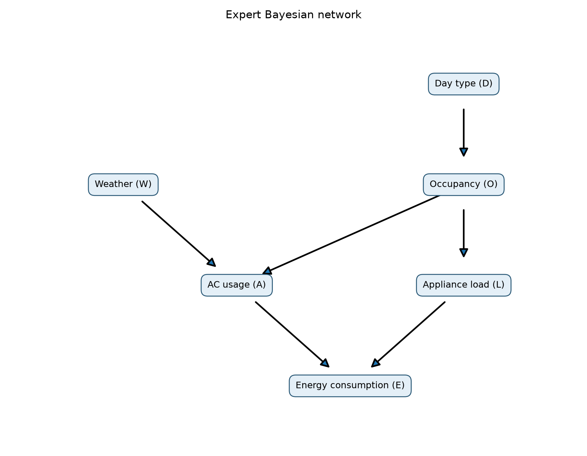
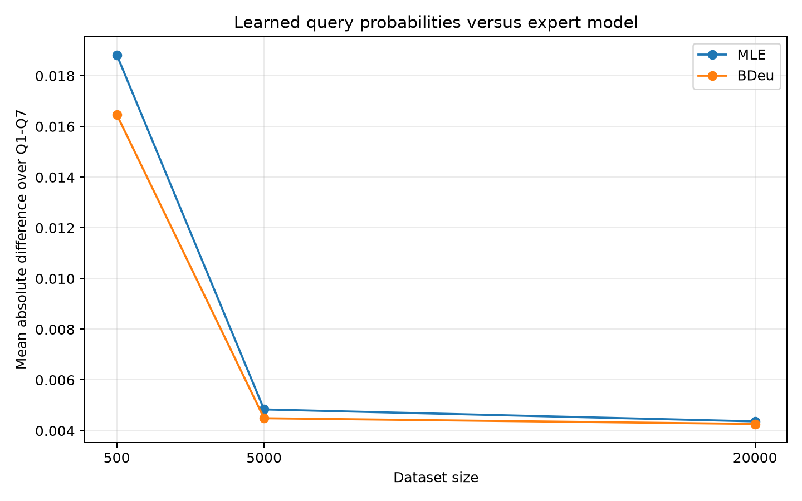

# AI Group Assignment 2

## Group members

Group: **Old I.N.D**

| Member | Roll number | Assigned work and review |
| --- | --- | --- |
| Vatsal Yadav | B24DS036 | Problem 1, Parts A-B: expert network, inference, hand calculation, independence |
| Rudra Dudhat | B24DS506 | Problem 1, Parts C-E: sampling, parameter learning, comparisons |
| Aryan Kose | B24EE009 | Problem 2, Tasks 1-6: PDDL, planning, verification, analysis |
| S Aparajith | B24DS50 | Problem 3, Tasks 1-6: FOL, CNF, Prolog, resolution proof |

All members: reproduce assigned results, capture genuine screenshots, review the
report, and check the final ZIP. This is a proposed responsibility allocation,
not a claim that each member has already completed or authored those sections.

Names and roll numbers are recorded exactly as supplied, including `B24DS50`.


# Problem 1: Smart home energy consumption

## A. Expert network and inference

The network has edges D -> O, W -> A, O -> A, O -> L, A -> E,
and L -> E. Its factorization is

`P(W,D,O,A,L,E) = P(W) P(D) P(O|D) P(A|W,O) P(L|O) P(E|A,L)`.

W is Weather, D is DayType, O is Occupancy, A is AC usage, L is ApplianceLoad,
and E is EnergyConsumption. The state labels follow the assignment. The code
constructs each CPT explicitly, checks each parent configuration sums to one,
and checks the 96-row joint distribution sums to one. Inference sums compatible
joint probabilities and divides by the probability of the evidence.



### Expert CPTs

Each row below lists probabilities in the stated state order.

**W**: states Hot, Mild, Cold; parents none.

| Parent configuration | Hot | Mild | Cold |
| --- | --- | --- | --- |
| prior | 0.5000 | 0.3000 | 0.2000 |

**D**: states Weekday, Weekend; parents none.

| Parent configuration | Weekday | Weekend |
| --- | --- | --- |
| prior | 0.7000 | 0.3000 |

**O**: states High, Low; parents D.

| Parent configuration | High | Low |
| --- | --- | --- |
| Weekday | 0.4500 | 0.5500 |
| Weekend | 0.8000 | 0.2000 |

**A**: states On, Off; parents W, O.

| Parent configuration | On | Off |
| --- | --- | --- |
| Hot, High | 0.9000 | 0.1000 |
| Hot, Low | 0.6000 | 0.4000 |
| Mild, High | 0.4000 | 0.6000 |
| Mild, Low | 0.1500 | 0.8500 |
| Cold, High | 0.1000 | 0.9000 |
| Cold, Low | 0.0500 | 0.9500 |

**L**: states Heavy, Light; parents O.

| Parent configuration | Heavy | Light |
| --- | --- | --- |
| High | 0.7500 | 0.2500 |
| Low | 0.3500 | 0.6500 |

**E**: states High, Low; parents A, L.

| Parent configuration | High | Low |
| --- | --- | --- |
| On, Heavy | 0.9200 | 0.0800 |
| On, Light | 0.6800 | 0.3200 |
| Off, Heavy | 0.5500 | 0.4500 |
| Off, Light | 0.1200 | 0.8800 |

### Query results

| Query | Probability | Result |
| --- | --- | --- |
| Q1 | P(E=High) | 0.5806310375 |
| Q2 | P(E=High given W=Hot) | 0.7062657500 |
| Q3 | P(E=High given D=Weekend) | 0.6401985000 |
| Q4 | P(E=High given W=Cold, O=High) | 0.4842500000 |
| Q5 | P(W=Hot given E=High) | 0.6081880785 |
| Q6 | P(A=On given E=High) | 0.6928666813 |
| Q7 | P(A=On given E=High, L=Heavy) | 0.6498993030 |

### Explaining away

Q6 is 0.6928666813 and Q7 is 0.6498993030. Observing high consumption makes
heavy AC use more likely. Once heavy appliance load is known, it provides
another explanation for high consumption, so the posterior probability of
AC use decreases. A and L also share the ancestor O; they are not marginally
independent causes. The numerical comparison still shows the explaining-away
effect requested in the assignment.

### Q1 by hand

Sum out the five other variables:

`P(E=High) = sum_w sum_d sum_o sum_a sum_l P(w)P(d)P(o|d)P(a|w,o)P(l|o)P(E=High|a,l)`.

First, `P(O=High) = 0.70*0.45 + 0.30*0.80 = 0.555`, so `P(O=Low)=0.445`.
W is independent of O because the unconditioned paths between them contain
colliders. For fixed w,o, write a=P(A=On|w,o) and l=P(L=Heavy|o).
Then summing the four A,L configurations gives

`g(w,o) = 0.92*a*l + 0.68*a*(1-l) + 0.55*(1-a)*l + 0.12*(1-a)*(1-l)`

`= 0.12 + 0.56*a + 0.43*l - 0.19*a*l`.

For O=High this is `0.4425 + 0.4175*a`; for O=Low it is
`0.2705 + 0.4935*a`. The remaining sum has six terms:

| W | O | P(w)P(o) | g(w,o) | Contribution |
| --- | --- | --- | --- | --- |
| Hot | High | 0.277500 | 0.81825000 | 0.2270643750 |
| Hot | Low | 0.222500 | 0.56660000 | 0.1260685000 |
| Mild | High | 0.166500 | 0.60950000 | 0.1014817500 |
| Mild | Low | 0.133500 | 0.34452500 | 0.0459940875 |
| Cold | High | 0.111000 | 0.48425000 | 0.0537517500 |
| Cold | Low | 0.089000 | 0.29517500 | 0.0262705750 |

Adding these contributions gives **0.5806310375**, matching exact code
inference to floating-point precision.

## B. Conditional independence

1. **W is independent of D.** The simple paths W -> A <- O <- D and
   W -> A -> E <- L <- O <- D are blocked by colliders A and E respectively.
2. **W is not independent of D given E.** Conditioning on E opens the collider
   E in the second path. E is also a descendant of collider A, so observing E
   opens the first path.
3. **W is independent of L given O.** The path W -> A <- O -> L is blocked by
   conditioned noncollider O (and its unobserved collider A). The other path
   W -> A -> E <- L is blocked by the unobserved collider E.

Numerical checks:

| Comparison | First value | Second value |
| --- | --- | --- |
| P(W=Hot) vs P(W=Hot given D=Weekend) | 0.5000000000 | 0.5000000000 |
| P(W=Hot given E=High) vs also D=Weekend | 0.6081880785 | 0.5997514833 |
| P(W=Hot given O=High) vs also L=Heavy | 0.5000000000 | 0.5000000000 |

`independence_checks.csv` checks every W,D state pair unconditionally and
for both E values, and every W,L state pair for both O values. Independence
uses joint-versus-product comparisons; one unequal pair is sufficient to
disprove conditional independence.

## C. Synthetic data

The sampler is implemented directly, without a library sampling routine.
It visits W,D,O,A,L,E in topological order and draws each state using the
appropriate CPT cumulative probability. The seed is **2026**, using Python's
`random.Random`. Generate 20,000 rows once and take prefixes of length 500,
5,000, and 20,000. The datasets are nested, not independent replicates.
The three CSV files contain the actual generated data.

### Dataset size 500

| Weather | Count | Frequency |
| --- | --- | --- |
| Hot | 270 | 0.540000 |
| Mild | 137 | 0.274000 |
| Cold | 93 | 0.186000 |

| Weather | Occupancy | Count |
| --- | --- | --- |
| Hot | High | 159 |
| Hot | Low | 111 |
| Mild | High | 71 |
| Mild | Low | 66 |
| Cold | High | 45 |
| Cold | Low | 48 |

### Dataset size 5000

| Weather | Count | Frequency |
| --- | --- | --- |
| Hot | 2509 | 0.501800 |
| Mild | 1490 | 0.298000 |
| Cold | 1001 | 0.200200 |

| Weather | Occupancy | Count |
| --- | --- | --- |
| Hot | High | 1400 |
| Hot | Low | 1109 |
| Mild | High | 817 |
| Mild | Low | 673 |
| Cold | High | 571 |
| Cold | Low | 430 |

### Dataset size 20000

| Weather | Count | Frequency |
| --- | --- | --- |
| Hot | 10068 | 0.503400 |
| Mild | 5956 | 0.297800 |
| Cold | 3976 | 0.198800 |

| Weather | Occupancy | Count |
| --- | --- | --- |
| Hot | High | 5584 |
| Hot | Low | 4484 |
| Mild | High | 3331 |
| Mild | Low | 2625 |
| Cold | High | 2198 |
| Cold | Low | 1778 |

## D. Parameter learning

The structure is held fixed for both estimators. For node i with r states,
q parent configurations, counts N_ijk, and parent count N_ij:

- MLE: `theta_ijk = N_ijk / N_ij`.
- Bayesian BDeu posterior mean: `theta_ijk = (N_ijk + 10/(r*q)) / (N_ij + 10/q)`.

The equivalent sample size is **10 per node**, spread uniformly over all its
CPT cells. Parameters are learned for every node, including both roots. State
spaces are fixed to the specification. All observed datasets contain every
parent configuration, so the uniform fallback for an unidentified MLE row is
never used. Full learned CPTs are saved in the six `cpts_*.json` files.

### Learned AC CPTs

Both On and Off probabilities are shown beside the expert CPT.

#### N = 500

| Weather | Occupancy | Expert_On | Expert_Off | MLE_On | MLE_Off | BDeu_On | BDeu_Off |
| --- | --- | --- | --- | --- | --- | --- | --- |
| Hot | High | 0.900000000 | 0.100000000 | 0.918238994 | 0.081761006 | 0.913900415 | 0.086099585 |
| Hot | Low | 0.600000000 | 0.400000000 | 0.603603604 | 0.396396396 | 0.602071006 | 0.397928994 |
| Mild | High | 0.400000000 | 0.600000000 | 0.380281690 | 0.619718310 | 0.383027523 | 0.616972477 |
| Mild | Low | 0.150000000 | 0.850000000 | 0.196969697 | 0.803030303 | 0.204433498 | 0.795566502 |
| Cold | High | 0.100000000 | 0.900000000 | 0.088888889 | 0.911111111 | 0.103571429 | 0.896428571 |
| Cold | Low | 0.050000000 | 0.950000000 | 0.041666667 | 0.958333333 | 0.057046980 | 0.942953020 |

#### N = 5000

| Weather | Occupancy | Expert_On | Expert_Off | MLE_On | MLE_Off | BDeu_On | BDeu_Off |
| --- | --- | --- | --- | --- | --- | --- | --- |
| Hot | High | 0.900000000 | 0.100000000 | 0.915714286 | 0.084285714 | 0.915219976 | 0.084780024 |
| Hot | Low | 0.600000000 | 0.400000000 | 0.605049594 | 0.394950406 | 0.604891957 | 0.395108043 |
| Mild | High | 0.400000000 | 0.600000000 | 0.429620563 | 0.570379437 | 0.429763844 | 0.570236156 |
| Mild | Low | 0.150000000 | 0.850000000 | 0.158989599 | 0.841010401 | 0.159832016 | 0.840167984 |
| Cold | High | 0.100000000 | 0.900000000 | 0.092819615 | 0.907180385 | 0.094004657 | 0.905995343 |
| Cold | Low | 0.050000000 | 0.950000000 | 0.041860465 | 0.958139535 | 0.043629344 | 0.956370656 |

#### N = 20000

| Weather | Occupancy | Expert_On | Expert_Off | MLE_On | MLE_Off | BDeu_On | BDeu_Off |
| --- | --- | --- | --- | --- | --- | --- | --- |
| Hot | High | 0.900000000 | 0.100000000 | 0.907772206 | 0.092227794 | 0.907650534 | 0.092349466 |
| Hot | Low | 0.600000000 | 0.400000000 | 0.604817128 | 0.395182872 | 0.604778182 | 0.395221818 |
| Mild | High | 0.400000000 | 0.600000000 | 0.398078655 | 0.601921345 | 0.398129626 | 0.601870374 |
| Mild | Low | 0.150000000 | 0.850000000 | 0.139428571 | 0.860571429 | 0.139657360 | 0.860342640 |
| Cold | High | 0.100000000 | 0.900000000 | 0.089626934 | 0.910373066 | 0.089937869 | 0.910062131 |
| Cold | Low | 0.050000000 | 0.950000000 | 0.042744657 | 0.957255343 | 0.043172879 | 0.956827121 |

## E. Comparison of query results

Absolute differences use the unrounded computed values.

### N = 500

| Query | Expert | MLE | Bayesian | AbsDiff_MLE | AbsDiff_Bayesian |
| --- | --- | --- | --- | --- | --- |
| Q1 | 0.580631038 | 0.592554211 | 0.590745732 | 0.011923173 | 0.010114694 |
| Q2 | 0.706265750 | 0.707970856 | 0.702865327 | 0.001705106 | 0.003400423 |
| Q3 | 0.640198500 | 0.653104782 | 0.646961488 | 0.012906282 | 0.006762988 |
| Q4 | 0.484250000 | 0.522060088 | 0.524402361 | 0.037810088 | 0.040152361 |
| Q5 | 0.608188078 | 0.645180230 | 0.637667009 | 0.036992152 | 0.029478931 |
| Q6 | 0.692866681 | 0.721506274 | 0.717685381 | 0.028639592 | 0.024818700 |
| Q7 | 0.649899303 | 0.651713775 | 0.649355322 | 0.001814472 | 0.000543981 |

### N = 5000

| Query | Expert | MLE | Bayesian | AbsDiff_MLE | AbsDiff_Bayesian |
| --- | --- | --- | --- | --- | --- |
| Q1 | 0.580631038 | 0.581638722 | 0.581483277 | 0.001007684 | 0.000852240 |
| Q2 | 0.706265750 | 0.706872714 | 0.706311878 | 0.000606964 | 4.61278060045478e-05 |
| Q3 | 0.640198500 | 0.645648548 | 0.645009075 | 0.005450048 | 0.004810575 |
| Q4 | 0.484250000 | 0.486527559 | 0.486851614 | 0.002277559 | 0.002601614 |
| Q5 | 0.608188078 | 0.609843731 | 0.609114328 | 0.001655652 | 0.000926249 |
| Q6 | 0.692866681 | 0.705686149 | 0.705295867 | 0.012819468 | 0.012429186 |
| Q7 | 0.649899303 | 0.659934848 | 0.659657170 | 0.010035545 | 0.009757867 |

### N = 20000

| Query | Expert | MLE | Bayesian | AbsDiff_MLE | AbsDiff_Bayesian |
| --- | --- | --- | --- | --- | --- |
| Q1 | 0.580631038 | 0.580005495 | 0.579967785 | 0.000625542 | 0.000663253 |
| Q2 | 0.706265750 | 0.710105206 | 0.709960033 | 0.003839456 | 0.003694283 |
| Q3 | 0.640198500 | 0.640395268 | 0.640242476 | 0.000196768 | 4.397587802085212e-05 |
| Q4 | 0.484250000 | 0.475909815 | 0.476011086 | 0.008340185 | 0.008238914 |
| Q5 | 0.608188078 | 0.616316507 | 0.616126533 | 0.008128428 | 0.007938454 |
| Q6 | 0.692866681 | 0.698532051 | 0.698437440 | 0.005665370 | 0.005570758 |
| Q7 | 0.649899303 | 0.653660835 | 0.653595220 | 0.003761532 | 0.003695917 |

### Mean absolute difference

| Dataset size | MLE | BDeu |
| --- | --- | --- |
| 500 | 0.018827266 | 0.016467440 |
| 5000 | 0.004836132 | 0.004489123 |
| 20000 | 0.004365326 | 0.004263651 |



### Largest error at N=500

Q4 is the largest-error query for both estimators: MLE error **0.037810088**,
BDeu error **0.040152361**. Its evidence W=Cold,O=High has probability
`0.20*0.555=0.111`, or 55.5 expected observations in 500 samples. The actual
dataset has only **45** such rows. This gives relatively little information
about the corresponding AC CPT row. Q4 also uses the learned appliance and
energy CPTs, so its error is not determined by that single evidence count.

### Which estimator performs better?

For this seeded 500-sample dataset, BDeu has the smaller mean absolute
difference: 0.016467440 versus MLE's 0.018827266. Its pseudocounts reduce
variance in sparsely observed CPT rows. This comes with shrinkage toward
uniform probabilities, which can add bias: BDeu is worse on Q2 and Q4 in
this run. It is therefore better on average here, not uniformly better.
Both estimators improve in average error across these three dataset sizes.
Individual queries need not improve monotonically; Q4 worsens between
5,000 and 20,000 rows. One seeded experiment does not establish universal
estimator superiority.


# Problem 2: Mars rover sample collection

## 1. Domain modeling

`Domain.pddl` declares only `:strips` and `:typing`. Types are rover, location,
rock, bay, and drill. Predicates record rover, rock and drill locations,
directed connectivity, bay ownership and contents, bay emptiness, rock type,
and permanent drill possession. `move`, `pick-drill`, `collect-soft`,
`collect-hard`, and `deposit` implement the four conceptual actions; collect
is split into two STRIPS actions to avoid disjunctive or negative preconditions.

Collection requires co-location and an empty owned bay, removes the rock's
ground location, and fills that bay. Hard collection additionally requires
the drill. Deposit is allowed at the current location, including locations
other than Base, as the brief permits. Pickup permanently records possession
of the drill; it does not consume a rock storage bay. Negative **effects**
are normal STRIPS deletes; no negative **preconditions** are used.

## 2. Problem modeling

`Problem.pddl` contains Curiosity, two empty bays, Drill1 at SiteE, and the
five rocks at their specified sites. Each two-way connection is represented
by two facts. Only SiteC -> SiteD is added for the downhill route.

`Problem_extended.pddl` adds soft Rock6 at SiteE and hard Rock7 at SiteF.
Both Base -> SiteB and SiteB -> Base are absent. Goals require all rocks
and the rover at Base; both bays must also be empty. Explicit empty-bay
goals in the extended problem are consistent with the base mission and
already follow from all rocks being on the ground at Base.

## 3. Search configurations and measured results

Pyperplan 2.1 parses and grounds the submitted PDDL files. Grounded operators
are sorted by name, and subprocesses fix `PYTHONHASHSEED=0` for repeatable
tie-breaking. Every action has unit cost.

- Satisficing: greedy best-first search with the FF delete-relaxation heuristic.
- Optimal: A* with the admissible rover lower bound implemented in
  `lower_bound.py`. No preferred-operator pruning or weighted A* is used.

### Why the A* heuristic is admissible

The handling bound counts two actions per undelivered ground rock (collect,
deposit), one per carried rock (deposit), and one drill pickup when an
undelivered hard rock requires it. These handling actions are necessary.

For movement, a cached dynamic program computes the shortest directed route
from the current location through every remaining ground-rock site and the
drill site when needed, ending at Base. It ignores storage capacity and
ordering constraints. Any real completion visits these sites, so this is
a movement lower bound. A second bound is the ceiling of half the sum of
the shortest distances to Base of all undelivered rocks, with carried rocks
starting at the rover. Each move transports at most two rocks by one edge.

The heuristic adds the handling bound to the **maximum** of these movement
bounds. Handling and movement use disjoint action types. Hence the total
never exceeds the true remaining action count and is zero at the goal.
Pyperplan's A* reopens states when a cheaper path is found, so consistency
is not needed for the optimality guarantee.

### Results

These are measured run results, not estimated runtimes. Planning wall time
includes parsing, grounding, and heuristic setup but excludes validation and
file writing. Search time excludes setup. Node counts follow Pyperplan's
convention and include the popped goal node. Plan length and total number
of executed actions are identical here because each plan is sequential.

| Scenario | Search | Plan length / total actions | Nodes expanded | Search time (s) | Planning time (s) |
| --- | --- | --- | --- | --- | --- |
| original | gbfs | 30 | 45 | 0.021144 | 0.059748 |
| original | astar | 25 | 1327 | 0.046020 | 0.063037 |
| extended | gbfs | 44 | 91 | 0.061587 | 0.095211 |
| extended | astar | 40 | 153190 | 7.017686 | 7.035978 |

### Complete action sequences

Each sequence below comes directly from the generated `.plan` file.
The corresponding `.json` files contain timings, action counts, and goals.

#### Original / gbfs

```text
01. (move curiosity base sitea)
02. (collect-soft curiosity rock1 bay1 sitea)
03. (move curiosity sitea base)
04. (deposit curiosity rock1 bay1 base)
05. (move curiosity base siteb)
06. (collect-soft curiosity rock2 bay1 siteb)
07. (move curiosity siteb base)
08. (deposit curiosity rock2 bay1 base)
09. (move curiosity base sitea)
10. (move curiosity sitea sitec)
11. (move curiosity sitec sitee)
12. (pick-drill curiosity drill1 sitee)
13. (move curiosity sitee sitec)
14. (collect-hard curiosity rock3 bay1 sitec)
15. (move curiosity sitec sited)
16. (collect-soft curiosity rock4 bay2 sited)
17. (move curiosity sited siteb)
18. (move curiosity siteb base)
19. (deposit curiosity rock3 bay1 base)
20. (deposit curiosity rock4 bay2 base)
21. (move curiosity base sitea)
22. (move curiosity sitea sitec)
23. (move curiosity sitec sitee)
24. (move curiosity sitee sitef)
25. (collect-hard curiosity rock5 bay1 sitef)
26. (move curiosity sitef sitee)
27. (move curiosity sitee sitec)
28. (move curiosity sitec sitea)
29. (move curiosity sitea base)
30. (deposit curiosity rock5 bay1 base)
```

#### Original / astar

```text
01. (move curiosity base siteb)
02. (collect-soft curiosity rock2 bay1 siteb)
03. (move curiosity siteb sited)
04. (collect-soft curiosity rock4 bay2 sited)
05. (move curiosity sited siteb)
06. (move curiosity siteb base)
07. (deposit curiosity rock2 bay1 base)
08. (deposit curiosity rock4 bay2 base)
09. (move curiosity base sitea)
10. (move curiosity sitea sitec)
11. (move curiosity sitec sitee)
12. (pick-drill curiosity drill1 sitee)
13. (move curiosity sitee sitef)
14. (collect-hard curiosity rock5 bay1 sitef)
15. (move curiosity sitef sitee)
16. (move curiosity sitee sitec)
17. (collect-hard curiosity rock3 bay2 sitec)
18. (move curiosity sitec sitea)
19. (move curiosity sitea base)
20. (deposit curiosity rock3 bay2 base)
21. (deposit curiosity rock5 bay1 base)
22. (move curiosity base sitea)
23. (collect-soft curiosity rock1 bay1 sitea)
24. (move curiosity sitea base)
25. (deposit curiosity rock1 bay1 base)
```

#### Extended / gbfs

```text
01. (move curiosity base sitea)
02. (collect-soft curiosity rock1 bay1 sitea)
03. (move curiosity sitea base)
04. (deposit curiosity rock1 bay1 base)
05. (move curiosity base sitea)
06. (move curiosity sitea sitec)
07. (move curiosity sitec sitee)
08. (pick-drill curiosity drill1 sitee)
09. (collect-soft curiosity rock6 bay1 sitee)
10. (move curiosity sitee sitec)
11. (move curiosity sitec sitea)
12. (move curiosity sitea base)
13. (deposit curiosity rock6 bay1 base)
14. (move curiosity base sitea)
15. (move curiosity sitea sitec)
16. (collect-hard curiosity rock3 bay1 sitec)
17. (move curiosity sitec sitea)
18. (move curiosity sitea base)
19. (deposit curiosity rock3 bay1 base)
20. (move curiosity base sitea)
21. (move curiosity sitea sitec)
22. (move curiosity sitec sited)
23. (move curiosity sited siteb)
24. (collect-soft curiosity rock2 bay1 siteb)
25. (move curiosity siteb sited)
26. (collect-soft curiosity rock4 bay2 sited)
27. (move curiosity sited sitee)
28. (move curiosity sitee sitec)
29. (move curiosity sitec sitea)
30. (move curiosity sitea base)
31. (deposit curiosity rock2 bay1 base)
32. (deposit curiosity rock4 bay2 base)
33. (move curiosity base sitea)
34. (move curiosity sitea sitec)
35. (move curiosity sitec sitee)
36. (move curiosity sitee sitef)
37. (collect-hard curiosity rock5 bay1 sitef)
38. (collect-hard curiosity rock7 bay2 sitef)
39. (move curiosity sitef sitee)
40. (move curiosity sitee sitec)
41. (move curiosity sitec sitea)
42. (move curiosity sitea base)
43. (deposit curiosity rock5 bay1 base)
44. (deposit curiosity rock7 bay2 base)
```

#### Extended / astar

```text
01. (move curiosity base sitea)
02. (move curiosity sitea sitec)
03. (move curiosity sitec sited)
04. (collect-soft curiosity rock4 bay1 sited)
05. (move curiosity sited siteb)
06. (collect-soft curiosity rock2 bay2 siteb)
07. (move curiosity siteb sited)
08. (move curiosity sited sitee)
09. (pick-drill curiosity drill1 sitee)
10. (move curiosity sitee sitec)
11. (move curiosity sitec sitea)
12. (move curiosity sitea base)
13. (deposit curiosity rock2 bay2 base)
14. (deposit curiosity rock4 bay1 base)
15. (move curiosity base sitea)
16. (move curiosity sitea sitec)
17. (move curiosity sitec sitee)
18. (move curiosity sitee sitef)
19. (collect-hard curiosity rock5 bay1 sitef)
20. (collect-hard curiosity rock7 bay2 sitef)
21. (move curiosity sitef sitee)
22. (move curiosity sitee sitec)
23. (move curiosity sitec sitea)
24. (move curiosity sitea base)
25. (deposit curiosity rock5 bay1 base)
26. (deposit curiosity rock7 bay2 base)
27. (move curiosity base sitea)
28. (move curiosity sitea sitec)
29. (move curiosity sitec sitee)
30. (collect-soft curiosity rock6 bay1 sitee)
31. (move curiosity sitee sitec)
32. (collect-hard curiosity rock3 bay2 sitec)
33. (move curiosity sitec sitea)
34. (move curiosity sitea base)
35. (deposit curiosity rock3 bay2 base)
36. (deposit curiosity rock6 bay1 base)
37. (move curiosity base sitea)
38. (collect-soft curiosity rock1 bay1 sitea)
39. (move curiosity sitea base)
40. (deposit curiosity rock1 bay1 base)
```

## 4. Goal verification

Every plan was replayed using the full grounded PDDL preconditions and
effects, with static facts and all operators retained. A separate simulator
implements the rover's movement, pickup, collection, and deposit rules.
The two final states must agree exactly. At every step it checks that the
rover has one location, each rock has one location or bay, each bay holds
at most one rock, and empty flags match bay contents. Preconditions also
check route direction, ownership, co-location, rock type, and drill possession.

All four plans passed both replays. The `.trace.txt` files show the dynamic
state after every action. The original plans finish with Rock1-Rock5 at Base;
the extended plans finish with Rock1-Rock7 at Base. Curiosity is at Base and
Bay1 and Bay2 are empty in every final state. The drill remains carried.
VAL was not used; validation was performed by the two described simulators.

## 5. Extended scenario

The storm removes only the Base-SiteB route. SiteB remains reachable through
SiteD. The optimal plan reaches SiteD by Base -> SiteA -> SiteC -> SiteD,
then reaches SiteB from SiteD. On returning, it travels SiteB -> SiteD ->
SiteE -> SiteC -> SiteA -> Base. It never uses the closed route or the
forbidden direct SiteD -> SiteC move.

## 6. Plan analysis

The original greedy plan takes 30 actions while A* takes 25. Both perform
five collections, five deposits, and one drill pickup; the difference is
19 versus 14 moves. The greedy heuristic chooses locally useful deliveries
and creates extra travel. The extended plans take 44 and 40 actions, with
29 and 25 moves respectively; both use seven collections, seven deposits,
and one pickup. The extra rocks and route closure increase required travel.

In the original optimal plan, Rock2 and Rock4 share the first return trip.
The rover then picks up the drill at **step 12**, before collecting Rock5
and Rock3 into the two bays. These are returned together. Rock1 is delivered
on the final short trip. Every hard-rock collection follows drill pickup.

In the extended optimal plan, Rock4 and Rock2 share the first return trip.
The rover picks up the drill at **step 9** while carrying them back, so later
hard-rock collections are enabled. Rock5 and Rock7 share the next trip from
SiteF, followed by Rock6 and Rock3, then Rock1. The directed SiteC -> SiteD
slope is used at **step 3**. Both bays are used whenever a useful pair is
available. These are particular optimal plans; another optimal sequence
may deliver rocks or choose bays in a different order.

## Planner reference

[Pyperplan source and usage](https://github.com/aibasel/pyperplan) documents
the STRIPS planner. This submission uses the installed **2.1** API; its
internal search registry calls greedy search `gbf`, while our wrapper uses
the clearer argument `--search gbfs`.


# Problem 3: Royal archive access verification

## 1. Knowledge representation

Constants are `mira`, `scroll_7`, and `royal_archive`. Variables x,y denote
people or records as appropriate in this single-sorted FOL encoding.

| Predicate | Meaning |
| --- | --- |
| Archivist(x) | x is an archivist |
| Verifies(x,r) | x verifies record r |
| Trusted(x) | x is trusted |
| Access(x,r) | x has access to r |
| Sealed(r) | r is sealed |
| Permitted(x,r) | x may inspect r |
| Inspects(x,r) | x actually inspects r |
| FindsMark(x,r) | x finds a hidden mark in r |
| Stored(r,a) | r is stored in archive a |

The formulas are:

1. `forall x,r: (Archivist(x) and Verifies(x,r)) -> Trusted(x)`.
2. `forall x,r: (Trusted(x) and Access(x,r) and Sealed(r)) -> Permitted(x,r)`.
3. `forall x,r: (Inspects(x,r) and FindsMark(x,r)) -> Verifies(x,r)`.
4. `forall r: Stored(r,royal_archive) -> Sealed(r)`.
5. `Stored(scroll_7,royal_archive)`.
6. `Access(mira,scroll_7)`.
7. `Inspects(mira,scroll_7) and FindsMark(mira,scroll_7)`.
8. `Archivist(mira)`.

`Permitted` and `Inspects` are different predicates. Permission does not
imply that an inspection actually occurred.

## 2. Negate the goal

The goal is `Trusted(mira)`. Add `not Trusted(mira)` to the knowledge base.
The program does not add the positive goal as a fact.

## 3. Conversion to clause form

The program represents formulas as terms and performs each transformation.
Implications become `not antecedent or consequent`. De Morgan's laws move
negations to predicates. For example, the first rule becomes

`forall x,r: not Archivist(x) or not Verifies(x,r) or Trusted(x)`.

Bound variables are renamed freshly for each scope. Clauses use distinct
variables across rules, and each resolution parent is copied separately
to standardize variables apart again. Variables printed as A,B in different
clauses are local to their clauses, not shared across them.

There are no existential quantifiers, so Skolemization introduces no new
symbols. Universal quantifiers are omitted in clause form. Disjunction is
distributed over conjunction when needed; the conjunction of the two
ground facts in formula 7 produces two unit clauses.

All variables in the following clauses are universally quantified:

| Clause | Literals |
| --- | --- |
| C1 | not Archivist(x1) or not Verifies(x1,r1) or Trusted(x1) |
| C2 | not Trusted(x2) or not Access(x2,r2) or not Sealed(r2) or Permitted(x2,r2) |
| C3 | not Inspects(x3,r3) or not FindsMark(x3,r3) or Verifies(x3,r3) |
| C4 | not Stored(r4,royal_archive) or Sealed(r4) |
| C5 | Stored(scroll_7,royal_archive) |
| C6 | Access(mira,scroll_7) |
| C7 | Inspects(mira,scroll_7) |
| C8 | FindsMark(mira,scroll_7) |
| C9 | Archivist(mira) |
| C10 | not Trusted(mira) |

## 4. Prolog implementation

`royal_archive_access.pl` contains the required eight labeled sections.
`main/0` prints the formulas, transformation stages, clauses, and proof.
`resolve/5` selects complementary literals, performs unification with an
occurs check, and returns the remaining literals. Set-of-support resolution
starts from the negated goal and prefers shorter new resolvents. This is a
procedure for the supplied knowledge base, not a claim of a complete
general-purpose first-order theorem prover.

## 5. Resolution refutation

The executed proof produces the following resolvents in order. Clause
variables are renamed below for readability; literal order is immaterial.

| New clause | Parents | Unification | Resolvent |
| --- | --- | --- | --- |
| C11 | C1, C10 | x1=mira | not Archivist(mira) or not Verifies(mira,r1) |
| C12 | C9, C11 | ground Archivist literal | not Verifies(mira,r1) |
| C13 | C3, C12 | x3=mira, r3=r1 | not Inspects(mira,r1) or not FindsMark(mira,r1) |
| C14 | C7, C13 | r1=scroll_7 | not FindsMark(mira,scroll_7) |
| C15 | C8, C14 | identical ground mark literals | [] |

C15 is the empty clause, a contradiction. Therefore the original knowledge
base entails `Trusted(mira)`. The substantive chain is that the observed
inspection and mark establish verification, and verification plus archivist
status establish trust. Rules about sealing, access and permission are not
needed for this conclusion.

## 6. Proof verification

The saved `outputs/proof_output.txt` is actual SWI-Prolog output. It ends
with `C15 = []`, the verified conclusion, and a passing self-test message.
The program replays every recorded resolution step against its parents.
Self-tests check preservation of repeated variables in CNF, ordinary and
occurs-check unification, absence of an assumed positive goal, and failure
to refute after separately removing the inspection, mark, or archivist fact.

Run manually from the repository root:

```powershell
swipl -q -s problem3/royal_archive_access.pl -g main -t halt
```

Use `screenshots/README.md` to capture genuine execution screenshots.

## Runtime reference

[SWI-Prolog downloads](https://www.swi-prolog.org/download/stable) provides
the runtime. The verified run used SWI-Prolog version 10.0.2 for x64-win64.
