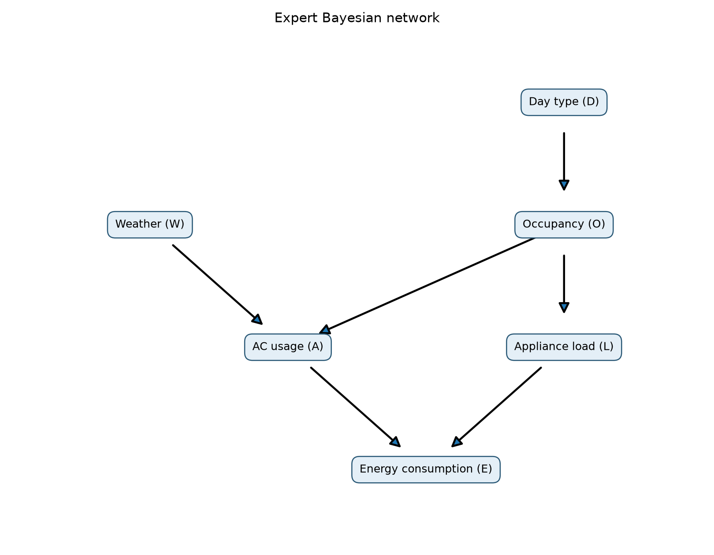
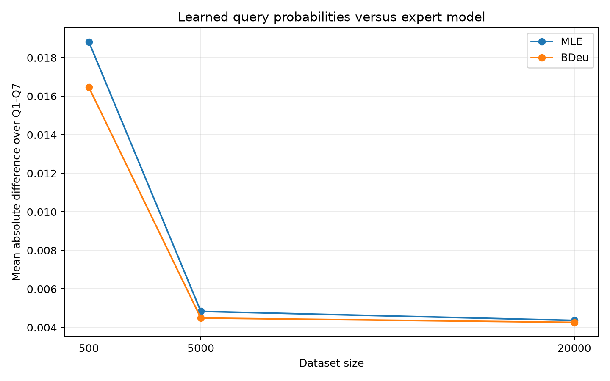

# Problem 1: Smart home energy consumption

## A. Expert network and inference

The network has edges D -> O, W -> A, O -> A, O -> L, A -> E,
and L -> E. Its factorization is

`P(W,D,O,A,L,E) = P(W) P(D) P(O|D) P(A|W,O) P(L|O) P(E|A,L)`.

W is Weather, D is DayType, O is Occupancy, A is AC usage, L is ApplianceLoad,
and E is EnergyConsumption. The state labels follow the assignment. The code
constructs each CPT explicitly, checks each parent configuration sums to one,
and checks the 96-row joint distribution sums to one. Inference sums compatible
joint probabilities and divides by the probability of the evidence.

### Expert CPTs

Each row below lists probabilities in the stated state order.

**W**: states Hot, Mild, Cold; parents none.

| Parent configuration | Hot | Mild | Cold |
| --- | --- | --- | --- |
| prior | 0.5000 | 0.3000 | 0.2000 |

**D**: states Weekday, Weekend; parents none.

| Parent configuration | Weekday | Weekend |
| --- | --- | --- |
| prior | 0.7000 | 0.3000 |

**O**: states High, Low; parents D.

| Parent configuration | High | Low |
| --- | --- | --- |
| Weekday | 0.4500 | 0.5500 |
| Weekend | 0.8000 | 0.2000 |

**A**: states On, Off; parents W, O.

| Parent configuration | On | Off |
| --- | --- | --- |
| Hot, High | 0.9000 | 0.1000 |
| Hot, Low | 0.6000 | 0.4000 |
| Mild, High | 0.4000 | 0.6000 |
| Mild, Low | 0.1500 | 0.8500 |
| Cold, High | 0.1000 | 0.9000 |
| Cold, Low | 0.0500 | 0.9500 |

**L**: states Heavy, Light; parents O.

| Parent configuration | Heavy | Light |
| --- | --- | --- |
| High | 0.7500 | 0.2500 |
| Low | 0.3500 | 0.6500 |

**E**: states High, Low; parents A, L.

| Parent configuration | High | Low |
| --- | --- | --- |
| On, Heavy | 0.9200 | 0.0800 |
| On, Light | 0.6800 | 0.3200 |
| Off, Heavy | 0.5500 | 0.4500 |
| Off, Light | 0.1200 | 0.8800 |

### Query results

| Query | Probability | Result |
| --- | --- | --- |
| Q1 | P(E=High) | 0.5806310375 |
| Q2 | P(E=High given W=Hot) | 0.7062657500 |
| Q3 | P(E=High given D=Weekend) | 0.6401985000 |
| Q4 | P(E=High given W=Cold, O=High) | 0.4842500000 |
| Q5 | P(W=Hot given E=High) | 0.6081880785 |
| Q6 | P(A=On given E=High) | 0.6928666813 |
| Q7 | P(A=On given E=High, L=Heavy) | 0.6498993030 |

### Explaining away

Q6 is 0.6928666813 and Q7 is 0.6498993030. Observing high consumption makes
heavy AC use more likely. Once heavy appliance load is known, it provides
another explanation for high consumption, so the posterior probability of
AC use decreases. A and L also share the ancestor O; they are not marginally
independent causes. The numerical comparison still shows the explaining-away
effect requested in the assignment.

### Q1 by hand

Sum out the five other variables:

`P(E=High) = sum_w sum_d sum_o sum_a sum_l P(w)P(d)P(o|d)P(a|w,o)P(l|o)P(E=High|a,l)`.

First, `P(O=High) = 0.70*0.45 + 0.30*0.80 = 0.555`, so `P(O=Low)=0.445`.
W is independent of O because the unconditioned paths between them contain
colliders. For fixed w,o, write a=P(A=On|w,o) and l=P(L=Heavy|o).
Then summing the four A,L configurations gives

`g(w,o) = 0.92*a*l + 0.68*a*(1-l) + 0.55*(1-a)*l + 0.12*(1-a)*(1-l)`

`= 0.12 + 0.56*a + 0.43*l - 0.19*a*l`.

For O=High this is `0.4425 + 0.4175*a`; for O=Low it is
`0.2705 + 0.4935*a`. The remaining sum has six terms:

| W | O | P(w)P(o) | g(w,o) | Contribution |
| --- | --- | --- | --- | --- |
| Hot | High | 0.277500 | 0.81825000 | 0.2270643750 |
| Hot | Low | 0.222500 | 0.56660000 | 0.1260685000 |
| Mild | High | 0.166500 | 0.60950000 | 0.1014817500 |
| Mild | Low | 0.133500 | 0.34452500 | 0.0459940875 |
| Cold | High | 0.111000 | 0.48425000 | 0.0537517500 |
| Cold | Low | 0.089000 | 0.29517500 | 0.0262705750 |

Adding these contributions gives **0.5806310375**, matching exact code
inference to floating-point precision.

## B. Conditional independence

1. **W is independent of D.** The simple paths W -> A <- O <- D and
   W -> A -> E <- L <- O <- D are blocked by colliders A and E respectively.
2. **W is not independent of D given E.** Conditioning on E opens the collider
   E in the second path. E is also a descendant of collider A, so observing E
   opens the first path.
3. **W is independent of L given O.** The path W -> A <- O -> L is blocked by
   conditioned noncollider O (and its unobserved collider A). The other path
   W -> A -> E <- L is blocked by the unobserved collider E.

Numerical checks:

| Comparison | First value | Second value |
| --- | --- | --- |
| P(W=Hot) vs P(W=Hot given D=Weekend) | 0.5000000000 | 0.5000000000 |
| P(W=Hot given E=High) vs also D=Weekend | 0.6081880785 | 0.5997514833 |
| P(W=Hot given O=High) vs also L=Heavy | 0.5000000000 | 0.5000000000 |

`independence_checks.csv` checks every W,D state pair unconditionally and
for both E values, and every W,L state pair for both O values. Independence
uses joint-versus-product comparisons; one unequal pair is sufficient to
disprove conditional independence.

## C. Synthetic data

The sampler is implemented directly, without a library sampling routine.
It visits W,D,O,A,L,E in topological order and draws each state using the
appropriate CPT cumulative probability. The seed is **2026**, using Python's
`random.Random`. Generate 20,000 rows once and take prefixes of length 500,
5,000, and 20,000. The datasets are nested, not independent replicates.
The three CSV files contain the actual generated data.

### Dataset size 500

| Weather | Count | Frequency |
| --- | --- | --- |
| Hot | 270 | 0.540000 |
| Mild | 137 | 0.274000 |
| Cold | 93 | 0.186000 |

| Weather | Occupancy | Count |
| --- | --- | --- |
| Hot | High | 159 |
| Hot | Low | 111 |
| Mild | High | 71 |
| Mild | Low | 66 |
| Cold | High | 45 |
| Cold | Low | 48 |

### Dataset size 5000

| Weather | Count | Frequency |
| --- | --- | --- |
| Hot | 2509 | 0.501800 |
| Mild | 1490 | 0.298000 |
| Cold | 1001 | 0.200200 |

| Weather | Occupancy | Count |
| --- | --- | --- |
| Hot | High | 1400 |
| Hot | Low | 1109 |
| Mild | High | 817 |
| Mild | Low | 673 |
| Cold | High | 571 |
| Cold | Low | 430 |

### Dataset size 20000

| Weather | Count | Frequency |
| --- | --- | --- |
| Hot | 10068 | 0.503400 |
| Mild | 5956 | 0.297800 |
| Cold | 3976 | 0.198800 |

| Weather | Occupancy | Count |
| --- | --- | --- |
| Hot | High | 5584 |
| Hot | Low | 4484 |
| Mild | High | 3331 |
| Mild | Low | 2625 |
| Cold | High | 2198 |
| Cold | Low | 1778 |

## D. Parameter learning

The structure is held fixed for both estimators. For node i with r states,
q parent configurations, counts N_ijk, and parent count N_ij:

- MLE: `theta_ijk = N_ijk / N_ij`.
- Bayesian BDeu posterior mean: `theta_ijk = (N_ijk + 10/(r*q)) / (N_ij + 10/q)`.

The equivalent sample size is **10 per node**, spread uniformly over all its
CPT cells. Parameters are learned for every node, including both roots. State
spaces are fixed to the specification. All observed datasets contain every
parent configuration, so the uniform fallback for an unidentified MLE row is
never used. Full learned CPTs are saved in the six `cpts_*.json` files.

### Learned AC CPTs

Both On and Off probabilities are shown beside the expert CPT.

#### N = 500

| Weather | Occupancy | Expert_On | Expert_Off | MLE_On | MLE_Off | BDeu_On | BDeu_Off |
| --- | --- | --- | --- | --- | --- | --- | --- |
| Hot | High | 0.900000000 | 0.100000000 | 0.918238994 | 0.081761006 | 0.913900415 | 0.086099585 |
| Hot | Low | 0.600000000 | 0.400000000 | 0.603603604 | 0.396396396 | 0.602071006 | 0.397928994 |
| Mild | High | 0.400000000 | 0.600000000 | 0.380281690 | 0.619718310 | 0.383027523 | 0.616972477 |
| Mild | Low | 0.150000000 | 0.850000000 | 0.196969697 | 0.803030303 | 0.204433498 | 0.795566502 |
| Cold | High | 0.100000000 | 0.900000000 | 0.088888889 | 0.911111111 | 0.103571429 | 0.896428571 |
| Cold | Low | 0.050000000 | 0.950000000 | 0.041666667 | 0.958333333 | 0.057046980 | 0.942953020 |

#### N = 5000

| Weather | Occupancy | Expert_On | Expert_Off | MLE_On | MLE_Off | BDeu_On | BDeu_Off |
| --- | --- | --- | --- | --- | --- | --- | --- |
| Hot | High | 0.900000000 | 0.100000000 | 0.915714286 | 0.084285714 | 0.915219976 | 0.084780024 |
| Hot | Low | 0.600000000 | 0.400000000 | 0.605049594 | 0.394950406 | 0.604891957 | 0.395108043 |
| Mild | High | 0.400000000 | 0.600000000 | 0.429620563 | 0.570379437 | 0.429763844 | 0.570236156 |
| Mild | Low | 0.150000000 | 0.850000000 | 0.158989599 | 0.841010401 | 0.159832016 | 0.840167984 |
| Cold | High | 0.100000000 | 0.900000000 | 0.092819615 | 0.907180385 | 0.094004657 | 0.905995343 |
| Cold | Low | 0.050000000 | 0.950000000 | 0.041860465 | 0.958139535 | 0.043629344 | 0.956370656 |

#### N = 20000

| Weather | Occupancy | Expert_On | Expert_Off | MLE_On | MLE_Off | BDeu_On | BDeu_Off |
| --- | --- | --- | --- | --- | --- | --- | --- |
| Hot | High | 0.900000000 | 0.100000000 | 0.907772206 | 0.092227794 | 0.907650534 | 0.092349466 |
| Hot | Low | 0.600000000 | 0.400000000 | 0.604817128 | 0.395182872 | 0.604778182 | 0.395221818 |
| Mild | High | 0.400000000 | 0.600000000 | 0.398078655 | 0.601921345 | 0.398129626 | 0.601870374 |
| Mild | Low | 0.150000000 | 0.850000000 | 0.139428571 | 0.860571429 | 0.139657360 | 0.860342640 |
| Cold | High | 0.100000000 | 0.900000000 | 0.089626934 | 0.910373066 | 0.089937869 | 0.910062131 |
| Cold | Low | 0.050000000 | 0.950000000 | 0.042744657 | 0.957255343 | 0.043172879 | 0.956827121 |

## E. Comparison of query results

Absolute differences use the unrounded computed values.

### N = 500

| Query | Expert | MLE | Bayesian | AbsDiff_MLE | AbsDiff_Bayesian |
| --- | --- | --- | --- | --- | --- |
| Q1 | 0.580631038 | 0.592554211 | 0.590745732 | 0.011923173 | 0.010114694 |
| Q2 | 0.706265750 | 0.707970856 | 0.702865327 | 0.001705106 | 0.003400423 |
| Q3 | 0.640198500 | 0.653104782 | 0.646961488 | 0.012906282 | 0.006762988 |
| Q4 | 0.484250000 | 0.522060088 | 0.524402361 | 0.037810088 | 0.040152361 |
| Q5 | 0.608188078 | 0.645180230 | 0.637667009 | 0.036992152 | 0.029478931 |
| Q6 | 0.692866681 | 0.721506274 | 0.717685381 | 0.028639592 | 0.024818700 |
| Q7 | 0.649899303 | 0.651713775 | 0.649355322 | 0.001814472 | 0.000543981 |

### N = 5000

| Query | Expert | MLE | Bayesian | AbsDiff_MLE | AbsDiff_Bayesian |
| --- | --- | --- | --- | --- | --- |
| Q1 | 0.580631038 | 0.581638722 | 0.581483277 | 0.001007684 | 0.000852240 |
| Q2 | 0.706265750 | 0.706872714 | 0.706311878 | 0.000606964 | 4.61278060045478e-05 |
| Q3 | 0.640198500 | 0.645648548 | 0.645009075 | 0.005450048 | 0.004810575 |
| Q4 | 0.484250000 | 0.486527559 | 0.486851614 | 0.002277559 | 0.002601614 |
| Q5 | 0.608188078 | 0.609843731 | 0.609114328 | 0.001655652 | 0.000926249 |
| Q6 | 0.692866681 | 0.705686149 | 0.705295867 | 0.012819468 | 0.012429186 |
| Q7 | 0.649899303 | 0.659934848 | 0.659657170 | 0.010035545 | 0.009757867 |

### N = 20000

| Query | Expert | MLE | Bayesian | AbsDiff_MLE | AbsDiff_Bayesian |
| --- | --- | --- | --- | --- | --- |
| Q1 | 0.580631038 | 0.580005495 | 0.579967785 | 0.000625542 | 0.000663253 |
| Q2 | 0.706265750 | 0.710105206 | 0.709960033 | 0.003839456 | 0.003694283 |
| Q3 | 0.640198500 | 0.640395268 | 0.640242476 | 0.000196768 | 4.397587802085212e-05 |
| Q4 | 0.484250000 | 0.475909815 | 0.476011086 | 0.008340185 | 0.008238914 |
| Q5 | 0.608188078 | 0.616316507 | 0.616126533 | 0.008128428 | 0.007938454 |
| Q6 | 0.692866681 | 0.698532051 | 0.698437440 | 0.005665370 | 0.005570758 |
| Q7 | 0.649899303 | 0.653660835 | 0.653595220 | 0.003761532 | 0.003695917 |

### Mean absolute difference

| Dataset size | MLE | BDeu |
| --- | --- | --- |
| 500 | 0.018827266 | 0.016467440 |
| 5000 | 0.004836132 | 0.004489123 |
| 20000 | 0.004365326 | 0.004263651 |

### Largest error at N=500

Q4 is the largest-error query for both estimators: MLE error **0.037810088**,
BDeu error **0.040152361**. Its evidence W=Cold,O=High has probability
`0.20*0.555=0.111`, or 55.5 expected observations in 500 samples. The actual
dataset has only **45** such rows. This gives relatively little information
about the corresponding AC CPT row. Q4 also uses the learned appliance and
energy CPTs, so its error is not determined by that single evidence count.

### Which estimator performs better?

For this seeded 500-sample dataset, BDeu has the smaller mean absolute
difference: 0.016467440 versus MLE's 0.018827266. Its pseudocounts reduce
variance in sparsely observed CPT rows. This comes with shrinkage toward
uniform probabilities, which can add bias: BDeu is worse on Q2 and Q4 in
this run. It is therefore better on average here, not uniformly better.
Both estimators improve in average error across these three dataset sizes.
Individual queries need not improve monotonically; Q4 worsens between
5,000 and 20,000 rows. One seeded experiment does not establish universal
estimator superiority.
